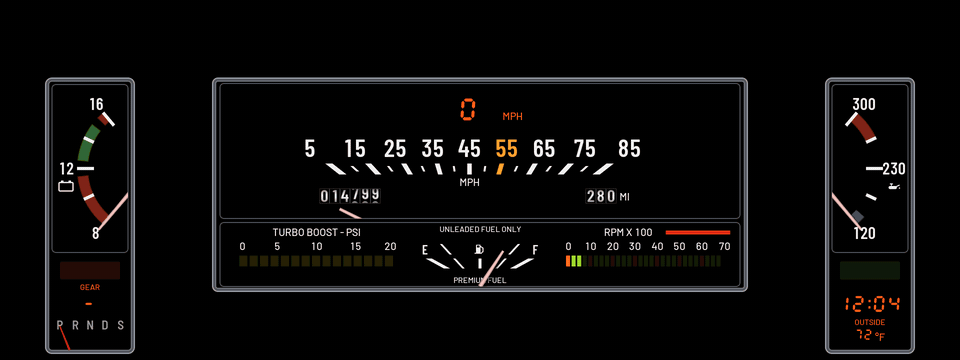
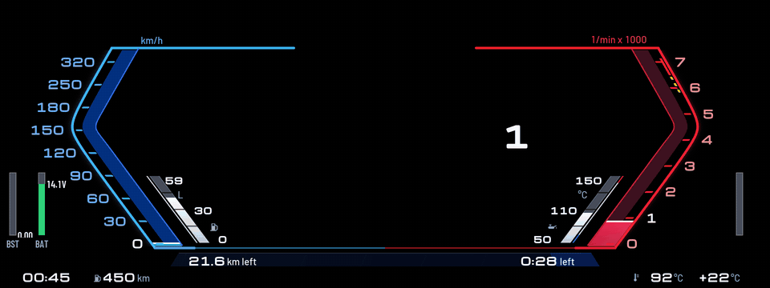
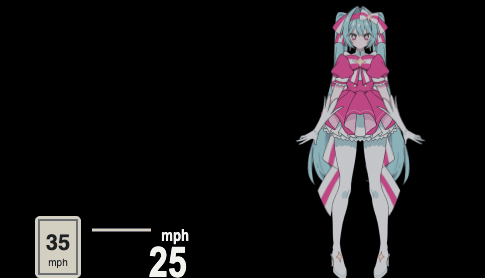
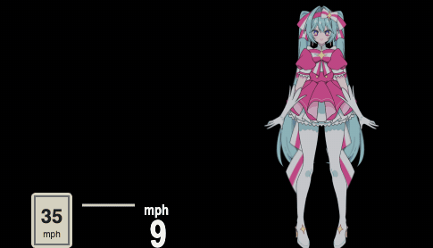

<h1 align="center">idrive7-custom</h1>

<p align="center">Apps for BMW iDrive 7 head units (MGU), installed through the community MGU Store. A reworked fork of [bimmer-lab/apps](https://github.com/bimmer-lab/apps) whose apps install next to the originals: they have their own ids (`custom_hud`, `custom_cluster`).</p>

## Custom Cluster

Redraws the whole instrument cluster as a 1987 Buick Grand National dash, and switches to a Sport view round BMW's map while route guidance is on. [Read more](apps/custom_cluster/README.md)

<p align="center"><br><sub>Grand National: the speed over the 55, the voltmeter and oil temperature pods with the range and clock, the rolling odometer under the 55 and P R N D S with its needle in the left pod</sub></p>

<p align="center"><br><sub>Sport while navigating: BMW's map shows in the middle (black here), the route's progress along the bottom</sub></p>

## Custom HUD

Puts your own Live2D character on the windshield HUD, standing beside BMW's speed and speed-limit sign: she leans as the car pulls away and brakes, and at a stop the view zooms in to a close-up of her, blinking, swaying and looking toward the indicator. It makes room for BMW's own HUD content: the layout steps aside while route guidance is up. [Read more](apps/custom_hud/README.md)

<p align="center"><br><sub>Driving: she leans as the car pulls away and brakes, beside BMW's own speed and speed-limit sign (bottom left)</sub></p>

<p align="center"><br><sub>Stopped: after 1 s she zooms into the close-up, filling the window from BMW's speed to the right edge, and zooms back out as the car moves off</sub></p>

<p align="center"><sub>Miku in the screenshots: the free Hatsune Miku "いますぐ輪廻" fan model by [Ruby_鸣哔うび](https://ko-fi.com/rubybee) (art) and 慈善小霓 (Live2D rigging), used under its personal, non-commercial terms. No model files are in this repo; you bake and copy your own model to your car.</sub></p>

## Install

1. Install **cluster-render** first. Both apps draw through it. Use 0.5.1 or later so both apps can show at once: either the `robertnisipeanu/idrive-apps` Store source or `james10424/idrive-apps-lib` (see [Both apps at once](#both-apps-at-once)).
2. In the Store, go to **Settings, Add source**, enter **`james10424/idrive7-custom`**, and install the apps you want.
3. Open the app from the apps menu on the center screen to pick a theme or layout.
4. For the Miku layout, bake your own Live2D model and copy it to the car: see [Your own Live2D character](#your-own-live2d-character).

The Store builds each app on the car from this repo. No BMW code is in it. Both apps are tested on a 2020 BMW M340i (G20); each app's page says what has been checked on the car and what is still open. Version history is in [CHANGELOG.md](CHANGELOG.md).

### Local deployment over SSH

To try a build on the car before releasing it, install it the way the Store does, with mgu-store's deploy tool (a checkout of `mgu-store` beside this repo, and SSH as root to the car; `deploy/hu connect` finds it, see mgu-store's `deploy/README.md`).

1. **Once, get the real oap-sdk from the car.** BMW's SDK is built into every stock app, so copy one off the car (`oap_12204` is x_call, the example in `kit/tools/extract_sdk.js`; any stock BMW app works):

   ```bash
   mkdir -p ~/oap-donor/javascript
   scp root@<car>:/var/opt/public/oap/oap_12204/source/package.json ~/oap-donor/
   scp root@<car>:/var/opt/public/oap/oap_12204/source/javascript/app.js ~/oap-donor/javascript/
   ```

2. **Build** with it (`oap-sdk/` is gitignored; the extract replaces the bench's stub there):

   ```bash
   node kit/tools/extract_sdk.js ~/oap-donor/javascript/app.js oap-sdk
   python3 kit/tools/build.py custom_hud
   ```

   This writes `dist/custom_hud@<version>.tgz` (`custom_cluster` the same way).

3. **Install** it, as the renderer test was:

   ```bash
   ../mgu-store/deploy/hu install --artifact dist/custom_hud@<version>.tgz
   ```

   The deploy tool marks it local (`"mguLocalOnly": true`).

**Live2D Render** (`native/live2d-render`, for Miku Live2D) installs the same way, as a tool. No oap-sdk needed: pack the committed `prebuilt/live2d-render` with its systemd units, then install that file:

```bash
../mgu-store/deploy/hu artifact native/live2d-render --out dist
../mgu-store/deploy/hu install --host <car> --identity <root key> --artifact dist/live2d-render@<version>.tgz
```

The tool goes to `/var/opt/live2d-render/current/` and its socket is enabled, as from the Store. After a change to its source, run `make prebuilt` in `native/live2d-render` first (its README, "Releasing"). The Cubism SDK and the model are still copied by hand ([Miku Live2D](#miku-live2d-drawn-live), steps 3 and 4). To take it off: `../mgu-store/deploy/hu uninstall live2d-render --yes` (with the same `--host` and `--identity`).

### When the HUD or the cluster stays off (the guard)

If the KOMBI restarts twice right after cluster-render shows a display (a shader it can't draw, say), cluster-render's guard turns that display off, even across reboots, and the app's status row says "cluster-render's guard disabled this display". Find out why first, or the next try restarts it again:

```bash
ssh root@<car> 'grep -E "guard|refused|error" /var/opt/cluster-render/log/cluster-render.log | tail -40'
```

Then reset it as root. `cluster-render` isn't on the car's `PATH`, so run the installed binary:

```bash
ssh root@<car> '/var/opt/cluster-render/current/cluster-render -c /var/opt/cluster-render/current/cluster-render.conf guard-reset'
```

It removes `/var/opt/cluster-render/state/guard.txt` and restarts cluster-render. Doing that by hand is the same:

```bash
ssh root@<car> 'rm -f /var/opt/cluster-render/state/guard.txt && systemctl restart cluster-render'
```

## Both apps at once

From cluster-render 0.5.1 on, the cluster panel has a scene id of its own (0x010004f8) and the HUD keeps 0x01000400, so Custom HUD and Custom Cluster show together with nothing to set. Before 0.5.1 they shared 0x01000400 and only one showed at a time: whichever asked first kept it, and the other waited ("waiting: the cluster layout has the scene the HUD shares" on Custom HUD's page). That message can still come back if the KOMBI refuses the panel's own id: cluster-render then falls back to the shared one for the rest of the boot and logs it.

The two sources differ in what the HUD gives way to:

- `robertnisipeanu/idrive-apps`: BMW's HUD lists (media source list, playlists, recent calls). Calls and apps' pop-ups only with `hud_yield_slots = 0x321,0x322` in the local conf.
- `james10424/idrive-apps-lib`: those lists, calls and apps' pop-ups, and BMW's route guidance.

Either way Custom HUD's own "Make room for BMW's guidance and cruise display" setting turns Miku off while BMW guides.

If the panel keeps falling back, `james10424/idrive-apps-lib` (0.4.5 or later) can move the HUD instead. The HUD then takes turns with cluster-render's `map` target (the Waze map on the cluster), not with the panel:

1. Over SSH as root, add the line to cluster-render's local conf (updates keep this file) and restart it:

   ```bash
   ssh root@<car> 'echo "hud_scene_id = 0x010004f0" >> /var/opt/cluster-render/cluster-render.local.conf && systemctl restart cluster-render'
   ```

2. Check it took:

   ```bash
   ssh root@<car> 'grep "target hud: .*0x10004f0" /var/opt/cluster-render/log/cluster-render.log | tail -1'
   ```

To undo, delete the line and restart cluster-render.

## Your own Live2D character

The Miku layout draws a Live2D model you own. Nothing of it ships with the app: you render it into frames on your computer and copy them to your car. Full details, including every bake setting, are in [tools/live2d_bake/README.md](tools/live2d_bake/README.md).

1. **What you need:** a Live2D model (Cubism 3 or newer: a `.model3.json` with its `.moc3` and textures) that you are allowed to use this way; Live2D's **Cubism Core** for the web (`Core/live2dcubismcore.min.js` from the [Cubism SDK for Web](https://www.live2d.com/en/sdk/download/web/), under Live2D's license); Node.js and a browser.
2. **Configure:** copy [tools/live2d_bake/example.json](tools/live2d_bake/example.json) next to your model. It uses Live2D's standard parameter names, so many models bake as it is. Set `lean.left` / `lean.right` to your model's braking and happy expressions, and `tails` to the part ids of long hair or ribbons to swing on their own.
3. **Bake:**

   ```bash
   node tools/live2d_bake/serve.js --model <model>.model3.json --core <sdk>/Core/live2dcubismcore.min.js --config <bake>.json --out <folder>
   ```

   Open `http://localhost:8095/?inspect` to see every part with its id (to fill in the config), then `http://localhost:8095/` to bake. It writes `atlas.json`, `atlas.etc2` and, with `close` in the config, `close.etc2` (ETC2, what the car loads; cluster-render 0.5.9 or later), the same as `.rgba`, and `preview.png` (for you) to `<folder>`. The bake refuses an atlas over 1024 px a side.
4. **Copy to the car** (Custom HUD installed, SSH as root):

   ```bash
   ./scripts/deploy.sh root@<car> --miku <folder>
   ```

   It finds Custom HUD's folder on the car and puts the bake's files in its `data/miku/`.
5. **Load:** on the center screen open **Custom HUD**, pick another layout, then **Miku** again. The status row should say "HUD on: Miku layout, 1 layer". Until the frames are there, the layout draws nothing and the status row says why.

To change her, bake again and run the deploy again; to remove her, run `./scripts/remove-miku.sh root@<car> --miku`.

### Miku Live2D: drawn live

The **Miku Live2D** layout draws her close-up live instead of from baked frames. Live2D Render ([native/live2d-render](native/live2d-render/README.md), a tool in this repo's Store source) draws her model on the head unit's GPU at 15 fps as its own video layer, and Custom HUD drives her as Miku Bake's close-up, blending her lean, head turn, idle loop and expressions smoothly instead of stepping between baked frames. Her hair and clothes move with the model's own physics.

Her poses come with the app: [apps/custom_hud/hud/miku-live/retrynowmiku.json](apps/custom_hud/hud/miku-live/retrynowmiku.json), made from RetrynowMiku's close-up bake config (parameter values only, no art). What you copy to the car by hand, once:

| What | Where on the car | How |
| --- | --- | --- |
| Live2D Render | `/var/opt/live2d-render/current/` | the Store (this repo's source) |
| Live2D's Cubism SDK (the glue library, Core, shaders) | `/var/opt/live2d-render/sdk/` | built on your computer, `make deploy-sdk` |
| Her model | `/var/opt/live2d-render/models/RetrynowMiku/` | `scripts/deploy.sh --miku-live` |

The SDK and the model never go in this repo: the SDK is under Live2D's licence and the art belongs to its owner.

1. **What you need:** cluster-render 0.6.0 or later on the car; root SSH to it; Docker on your computer; [Cubism SDK for Native](https://www.live2d.com/en/sdk/download/native/) 5-r.5, unzipped; and the model (a `.model3.json` with its `.moc3`, physics and textures).
2. **Install** Custom HUD 0.1.41 or later and **Live2D Render** from the Store (this repo's source lists both). Alone Live2D Render draws nothing: until the SDK is there it answers "no Cubism glue library".
3. **Build and copy the SDK:**

   ```bash
   cd native/live2d-render
   make glue SDK=~/Downloads/CubismSdkForNative-5-r.5
   make deploy-sdk CAR=root@<car>
   ```

   `make glue` builds in Docker, for the head unit's userland, into `native/live2d-render/build/sdk/` (ignored by git); `make deploy-sdk` copies it to `/var/opt/live2d-render/sdk/`. Do it again only when a Live2D Render update changes its glue (it refuses an old one and says "rebuild it: make glue").
4. **Copy her model:**

   ```bash
   ./scripts/deploy.sh root@<car> --miku-live <model>.model3.json
   ```

   It copies the model, its textures shrunk to 1024 px (they draw the close-up just as well), to `/var/opt/live2d-render/models/<model>/`, where the layout's `model` points (`/var/opt/live2d-render/models/RetrynowMiku/RetrynowMiku.model3.json`). The model goes as a `tar` stream over `ssh` (plain ustar, no macOS `._` files, unpacked by the car's BusyBox `tar` as root's files), not `scp -r`: the Mac's `scp` can't upload a folder such as `RetrynowMiku.4096` into one the car doesn't have yet ("path canonicalization failed"). Running it again replaces the model; an earlier failed copy needs no cleaning up.
5. **Load:** on the center screen open **Custom HUD** and pick **Miku Live2D** under Layout (if it was already picked, pick another layout and back). The first time takes about a second while Live2D Render starts and loads her.

After that, app updates bring new poses with them; the model and the SDK stay on the car.

Until everything is there nothing is drawn, and the status row says what is missing:

| Status row | What to do |
| --- | --- |
| Miku Live2D: live2d-render isn't installed | step 2 |
| Miku Live2D: no Cubism glue library ... | step 3 |
| Miku Live2D: cannot read ... model3.json | step 4 |
| Miku Live2D: the head unit restarted while live2d-render was drawing ... | below |

**If the head unit restarted while she was drawing,** Live2D Render refuses to draw again until you have looked into it (it is the one process here that drives the GPU itself, and a GPU fault once restarted the whole unit). To let it draw again:

```bash
ssh root@<car> 'rm /var/opt/live2d-render/state/drawing'
```

After 3 crashes of its own in one boot it also stops until the next start. Its log: `ssh root@<car> journalctl -u live2d-render`; every few seconds while drawing it logs its frame rate and how much of each frame it takes (about 39% for RetrynowMiku).

**On the bench** (the Mac's Display Bench), Miku Live2D runs the real Live2D Render in Docker on Mesa's software renderer, at about 15 fps. Build its glue as in step 3 (`make glue`), then copy the model to the bench once:

```bash
node bench/live2d.js <model>.model3.json
```

The bench starts it by itself from then on (Docker running), and stops it with the bench; without it the status row says Live2D Render isn't running. The bench's header shows its state (`live2d: running`, `paused` while redraw is off, `stopped`), and its **Start Live2D Render** button starts it, or starts it afresh when it's stuck (once, after a long pause, it spun without drawing); the HUD finds it again within 3 s.

**New poses.** Bake a new close-up config (tools/live2d_bake) and turn it into the app's pose file, expressions written in:

```bash
node tools/live2d_bake/live_pose.js <bake config.json> <model folder> apps/custom_hud/hud/miku-live/retrynowmiku.json
```

To try a config on the car before building the app, `./scripts/deploy.sh root@<car> --miku-live-config <bake config.json> <model>.model3.json` puts it (and the expressions it names, from next to the model) in Custom HUD's `data/miku-live/`, which the layout reads in place of the app's poses until you delete that folder.

**To remove her,** pick another layout and delete `/var/opt/live2d-render/models/<model>/`; uninstalling Live2D Render from the Store leaves `/var/opt/live2d-render/sdk/` behind, so delete that too.

## Measuring what the apps take

```bash
tools/car_usage.sh root@<car> 30        # one 30 s window
tools/car_usage.sh root@<car> 10 6      # a minute, a table every 10 s
```

For Custom HUD, Custom Cluster, cluster-render and Live2D Render: each process's CPU over the window (% of one core; the head unit has 4), its memory (RSS) and threads, and all of them together. Then the busiest other processes (BMW's own HMI), the whole unit's CPU and available memory, the GPU's clock (it climbs from idle as the GPU works), and Live2D Render's own last timing line from its log. It only reads `/proc` and `/sys` on the car; what runs there is `tools/car_usage.remote.sh` (BusyBox sh). `tools/car_usage.sh - 5` runs it on the machine you're on instead, for trying it on any Linux.

## Credits

- [bimmer-lab/apps](https://github.com/bimmer-lab/apps) (MIT): the original HUD Widgets and Cluster Themes this repo starts from.
- [cauliflowermossgrape/idrive7-apps](https://github.com/cauliflowermossgrape/idrive7-apps): the MGU App Kit (MIT) these apps are built on, and the Redline app the shift scoring comes from.
- [robertnisipeanu/idrive-apps](https://github.com/robertnisipeanu/idrive-apps): cluster-render, which draws on the HUD and the cluster.
- Barlow and Michroma typefaces (SIL Open Font License).
- The free Hatsune Miku "いますぐ輪廻" fan model by [Ruby_鸣哔うび](https://ko-fi.com/rubybee) (art) and 慈善小霓 (Live2D rigging), used under its personal, non-commercial terms. No model files are in this repo; you bake and copy your own model to your car.
- [Live2D Cubism](https://www.live2d.com/): the bake runs on Cubism Core, which you download from Live2D yourself (not in this repo).

## Licence

MIT. Third-party parts are listed in each app's `NOTICE`. To work on the apps, see [docs/DEVELOPING.md](docs/DEVELOPING.md).
