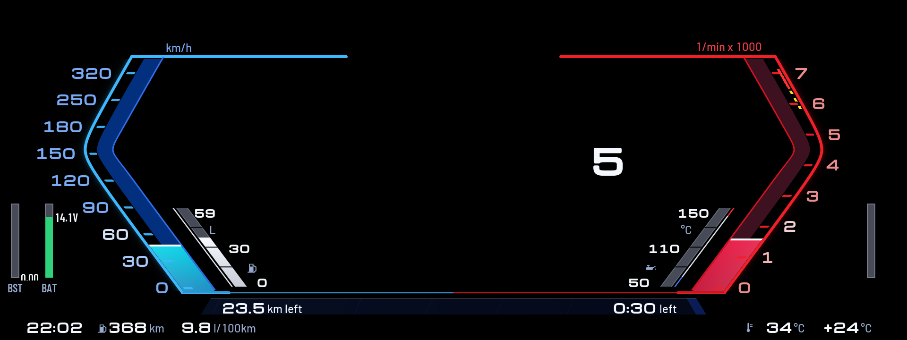
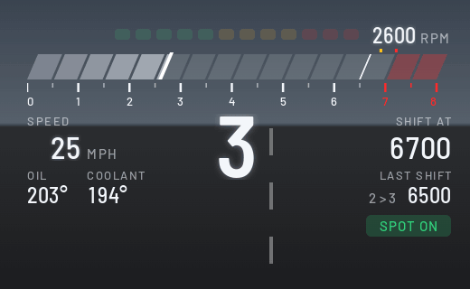
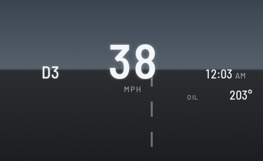
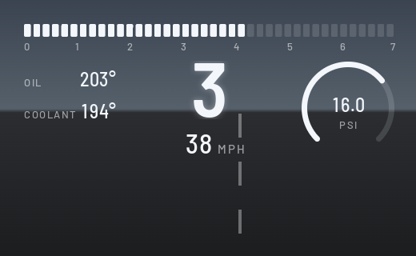
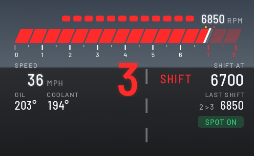

<h1 align="center">idrive7-custom</h1>

Apps for BMW iDrive 7 head units (MGU), installed through the community MGU Store. A reworked fork of [bimmer-lab/apps](https://github.com/bimmer-lab/apps) whose apps install next to the originals: they have their own ids (`custom_hud`, `custom_cluster`).

## Custom Cluster

Redraws the whole instrument cluster as a 1987 Buick Regal dash, and switches to a Sport view round BMW's map while route guidance is on. [Read more](apps/custom_cluster/README.md)

## Custom HUD

Puts your own readouts on the windshield HUD: speed, gear, shift lights, boost, oil and coolant. Three layouts, each in Classic, M and Night colours. It makes room for BMW's own HUD content: the layout moves aside while route guidance or the ACC display is up, and shows the gap to the car ahead in cruise. [Read more](apps/custom_hud/README.md)

<table align="center">
  <tr>
    <th align="center">Daily</th>
    <th align="center">Sport</th>
    <th align="center">Redline</th>
  </tr>
  <tr>
    <td></td>
    <td></td>
    <td></td>
  </tr>
</table>

## Install

1. Install **cluster-render** first. Both apps draw through it. It comes from the `robertnisipeanu/idrive-apps` Store source.
2. In the Store, go to **Settings, Add source**, enter **`james10424/idrive7-custom`**, and install the apps you want.
3. Open the app from the apps menu on the center screen to pick a theme or layout.

The Store builds each app on the car from this repo. No BMW code is in it. Both apps are tested on a 2020 X3 M40i; each app's page says what has been checked on the car and what is still open. Version history is in [CHANGELOG.md](CHANGELOG.md).

## Credits

- [bimmer-lab/apps](https://github.com/bimmer-lab/apps) (MIT): the original HUD Widgets and Cluster Themes this repo starts from.
- [cauliflowermossgrape/idrive7-apps](https://github.com/cauliflowermossgrape/idrive7-apps): the MGU App Kit (MIT) these apps are built on, and the Redline app the shift scoring comes from.
- [robertnisipeanu/idrive-apps](https://github.com/robertnisipeanu/idrive-apps): cluster-render, which draws on the HUD and the cluster.
- Barlow and Michroma typefaces (SIL Open Font License).

## Licence

MIT. Third-party parts are listed in each app's `NOTICE`. To work on the apps, see [docs/DEVELOPING.md](docs/DEVELOPING.md).
