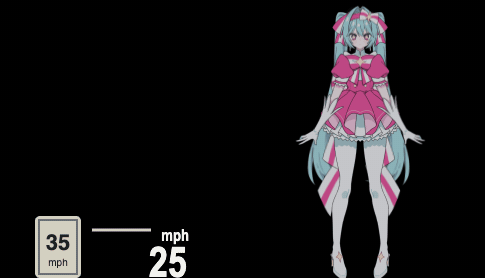
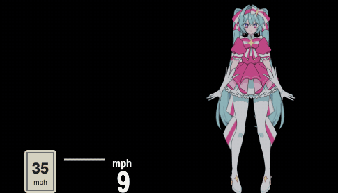

<h1 align="center">idrive7-custom</h1>

<p align="center">Apps for BMW iDrive 7 head units (MGU), installed through the community MGU Store. A reworked fork of [bimmer-lab/apps](https://github.com/bimmer-lab/apps) whose apps install next to the originals: they have their own ids (`custom_hud`, `custom_cluster`).</p>

## Custom Cluster

Redraws the whole instrument cluster as a 1987 Buick Grand National dash, and switches to a Sport view round BMW's map while route guidance is on. [Read more](apps/custom_cluster/README.md)

<p align="center"><br><sub>Grand National: the speed over the 55, the voltmeter and oil temperature pods with the range and clock, the rolling odometer under the 55 and P R N D S with its needle in the left pod</sub></p>

<p align="center"><br><sub>Sport while navigating: BMW's map shows in the middle (black here), the route's progress along the bottom</sub></p>

## Custom HUD

Puts your own Live2D character on the windshield HUD, standing beside BMW's speed and speed-limit sign: she leans as the car pulls away and brakes, and at a stop the view zooms in to a close-up of her, blinking, swaying and looking toward the indicator. It makes room for BMW's own HUD content: the layout steps aside while route guidance is up. [Read more](apps/custom_hud/README.md)

<p align="center"><br><sub>Driving: she leans as the car pulls away and brakes, beside BMW's own speed and speed-limit sign (bottom left)</sub></p>

<p align="center"><br><sub>Stopped: after 1 s she zooms into the close-up, filling the window from BMW's speed to the right edge, and zooms back out as the car moves off</sub></p>

<p align="center"><sub>Miku in the screenshots: the free Hatsune Miku "いますぐ輪廻" fan model by [Ruby_鸣哔うび](https://ko-fi.com/rubybee) (art) and 慈善小霓 (Live2D rigging), used under its personal, non-commercial terms. No model files are in this repo; you bake and copy your own model to your car.</sub></p>

## Install

1. Install **cluster-render** first. Both apps draw through it. Use 0.5.1 or later so both apps can show at once: either the `robertnisipeanu/idrive-apps` Store source or `james10424/idrive-apps-lib` (see [Both apps at once](#both-apps-at-once)).
2. In the Store, go to **Settings, Add source**, enter **`james10424/idrive7-custom`**, and install the apps you want.
3. Open the app from the apps menu on the center screen to pick a theme or layout.
4. For the Miku layout, bake your own Live2D model and copy it to the car: see [Your own Live2D character](#your-own-live2d-character).

The Store builds each app on the car from this repo. No BMW code is in it. Both apps are tested on a 2020 BMW M340i (G20); each app's page says what has been checked on the car and what is still open. Version history is in [CHANGELOG.md](CHANGELOG.md).

### Local deployment over SSH

For your own layouts and Miku bakes, push files straight to the installed app from this repo, with no Store release. You need SSH as root to the car (`root@<car>`, its IP or hostname) and the app installed from the Store first. The scripts find the app's folder on the car (`/var/opt/public/oap/oap_<uid>/`, by its `source/package.json`) and keep the files' owner.

- **Layouts** land in the app's `data/layouts/`, where a file overrides the built-in layout of the same name. The app watches that folder and redraws by itself. With no files, the script pushes the repo's built-in layouts.

  ```bash
  ./scripts/deploy.sh root@<car> my-layout.json
  ```

  ```bash
  APP=custom_cluster ./scripts/deploy.sh root@<car> regal.json
  ```

  Delete a file from `data/layouts/` to go back to the built-in layout.

- **Miku bakes** land in Custom HUD's `data/miku/`: `atlas.json`, `atlas.etc2`, and `close.etc2` and `idle.etc2` when the bake made them. Old frames are removed first. Switch to another layout and back (or restart the app) to load them. ETC2 needs cluster-render 0.5.9 or later.

  ```bash
  ./scripts/deploy.sh root@<car> --miku <bake folder>
  ```

- **Remove Miku's frames** (`-y` skips the question; your bake folders stay):

  ```bash
  ./scripts/remove-miku.sh root@<car> --miku
  ```

App code itself (`apps/`, `shared/`) still comes from the Store: push a release tag and update the app there.

## Both apps at once

From cluster-render 0.5.1 on, the cluster panel has a scene id of its own (0x010004f8) and the HUD keeps 0x01000400, so Custom HUD and Custom Cluster show together with nothing to set. Before 0.5.1 they shared 0x01000400 and only one showed at a time: whichever asked first kept it, and the other waited ("waiting: the cluster layout has the scene the HUD shares" on Custom HUD's page). That message can still come back if the KOMBI refuses the panel's own id: cluster-render then falls back to the shared one for the rest of the boot and logs it.

The two sources differ in what the HUD gives way to:

- `robertnisipeanu/idrive-apps`: BMW's HUD lists (media source list, playlists, recent calls). Calls and apps' pop-ups only with `hud_yield_slots = 0x321,0x322` in the local conf.
- `james10424/idrive-apps-lib`: those lists, calls and apps' pop-ups, and BMW's route guidance.

Either way Custom HUD's own "Make room for BMW's guidance and cruise display" setting turns Miku off while BMW guides.

If the panel keeps falling back, `james10424/idrive-apps-lib` (0.4.5 or later) can move the HUD instead. The HUD then takes turns with cluster-render's `map` target (the Waze map on the cluster), not with the panel:

1. Over SSH as root, add the line to cluster-render's local conf (updates keep this file) and restart it:

   ```bash
   ssh root@<car> 'echo "hud_scene_id = 0x010004f0" >> /var/opt/cluster-render/cluster-render.local.conf && systemctl restart cluster-render'
   ```

2. Check it took:

   ```bash
   ssh root@<car> 'grep "target hud: .*0x10004f0" /var/opt/cluster-render/log/cluster-render.log | tail -1'
   ```

To undo, delete the line and restart cluster-render.

## Your own Live2D character

The Miku layout draws a Live2D model you own. Nothing of it ships with the app: you render it into frames on your computer and copy them to your car. Full details, including every bake setting, are in [tools/live2d_bake/README.md](tools/live2d_bake/README.md).

1. **What you need:** a Live2D model (Cubism 3 or newer: a `.model3.json` with its `.moc3` and textures) that you are allowed to use this way; Live2D's **Cubism Core** for the web (`Core/live2dcubismcore.min.js` from the [Cubism SDK for Web](https://www.live2d.com/en/sdk/download/web/), under Live2D's license); Node.js and a browser.
2. **Configure:** copy [tools/live2d_bake/example.json](tools/live2d_bake/example.json) next to your model. It uses Live2D's standard parameter names, so many models bake as it is. Set `lean.left` / `lean.right` to your model's braking and happy expressions, and `tails` to the part ids of long hair or ribbons to swing on their own.
3. **Bake:**

   ```bash
   node tools/live2d_bake/serve.js --model <model>.model3.json --core <sdk>/Core/live2dcubismcore.min.js --config <bake>.json --out <folder>
   ```

   Open `http://localhost:8095/?inspect` to see every part with its id (to fill in the config), then `http://localhost:8095/` to bake. It writes `atlas.json`, `atlas.etc2` and, with `close` in the config, `close.etc2` (ETC2, what the car loads; cluster-render 0.5.9 or later), the same as `.rgba`, and `preview.png` (for you) to `<folder>`. The bake refuses an atlas over 1024 px a side.
4. **Copy to the car** (Custom HUD installed, SSH as root):

   ```bash
   ./scripts/deploy.sh root@<car> --miku <folder>
   ```

   It finds Custom HUD's folder on the car and puts the bake's files in its `data/miku/` (see [Local deployment over SSH](#local-deployment-over-ssh)).
5. **Load:** on the center screen open **Custom HUD**, pick another layout, then **Miku** again. The status row should say "HUD on: Miku layout, 1 layer". Until the frames are there, the layout draws nothing and the status row says why.

To change her, bake again and run the deploy again; to remove her, run `./scripts/remove-miku.sh root@<car> --miku`.

## Credits

- [bimmer-lab/apps](https://github.com/bimmer-lab/apps) (MIT): the original HUD Widgets and Cluster Themes this repo starts from.
- [cauliflowermossgrape/idrive7-apps](https://github.com/cauliflowermossgrape/idrive7-apps): the MGU App Kit (MIT) these apps are built on, and the Redline app the shift scoring comes from.
- [robertnisipeanu/idrive-apps](https://github.com/robertnisipeanu/idrive-apps): cluster-render, which draws on the HUD and the cluster.
- Barlow and Michroma typefaces (SIL Open Font License).
- The free Hatsune Miku "いますぐ輪廻" fan model by [Ruby_鸣哔うび](https://ko-fi.com/rubybee) (art) and 慈善小霓 (Live2D rigging), used under its personal, non-commercial terms. No model files are in this repo; you bake and copy your own model to your car.
- [Live2D Cubism](https://www.live2d.com/): the bake runs on Cubism Core, which you download from Live2D yourself (not in this repo).

## Licence

MIT. Third-party parts are listed in each app's `NOTICE`. To work on the apps, see [docs/DEVELOPING.md](docs/DEVELOPING.md).
