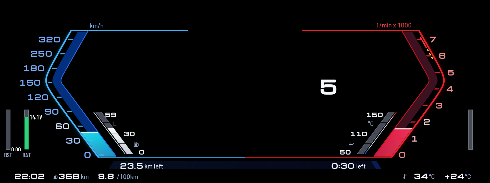
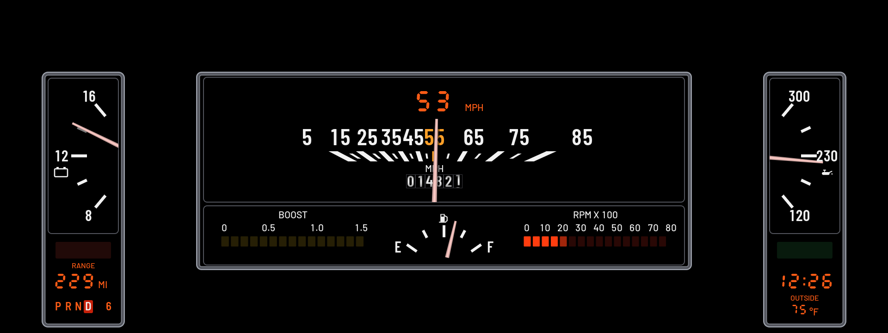

# Custom Cluster

Redraws the whole instrument cluster: a 1987 Buick Regal dash, switching to a Sport view round BMW's map while you navigate. Open **Custom Cluster** from the apps menu on the center screen to change it.

## Themes

### Sport

The look of BMW's newer Live Cockpit Sport view.

- **Left:** speed as a blue bracket on BMW's 0 to 200 mph scale (0 to 320 km/h), with the digital speed and a fuel bar inside it.
- **Right:** revs as a red bracket on the M40i's 0 to 7000 rpm scale, with yellow and red marks around your redline, with the gear and an oil temperature bar inside it.
- **Middle:** BMW's map while navigating (or with "Leave room for the map" on), else black.
- **Bottom:** boost and coolant in the blue and red strip, plus the clock, range and outside temperature.
- **While navigating:** the strip becomes the route's progress, filling from the right, with the distance left and the time left at its ends.

 While navigating: BMW's map shows in the middle (black here)

### Regal (1987)

The look of a 1987 Buick Regal's dash: chrome frames, white numbers, pink needles and an orange VFD.

- **Left pod:** a 12 V voltmeter (8 to 16 V), with the parking brake lamp (red PARK BRAKE, or green AUTO HOLD while Auto Hold holds the car), the range (in orange VFD digits) and the average fuel consumption under it.
- **Right pod:** oil temperature (50 / 110 / 150 °C), with the CRUISE lamp (lit green while ACC is on), the clock and the outside temperature under it.
- **Middle, top:** a needle over a straight row of mph numbers, 5 to 85, with 55 in amber at the centre. Over the 55, the speed in big orange VFD digits (mph or km/h by the units setting); under it, P R N D with the gear number, the lit one boxed, and the needle sweeps over them. No turn signals: BMW's own indicator sound stays.
- **Middle, bottom:** the fuel needle in the middle, a yellow LED boost bar (0 to 1.5 bar) on its left and an LED rev bar that turns yellow from your shift point on its right.
- **Bottom:** BMW's belt light and gear letter. There is no map window.
- **On the ledge:** your own Live2D character (Miku with the RetrynowMiku model) sits on the ledge between the speed window and the lower window, at its left end, facing you, her legs hanging over the boost bar. She blinks and breathes and swings her legs, one forward as the other goes back; stopped for 15 s she dozes: 5 s asleep (eyes shut, legs still, breathing slower), 5 s awake, and so on, the same loop as Custom HUD's Miku. No character ships with the app: bake her with [tools/live2d_bake](../../tools/live2d_bake/README.md#sitting-custom-cluster) and deploy with `--miku-sit`. Without the bake nothing is drawn there.

More themes are on the way.

## Navigation and Off

- **While navigating:** while BMW's route guidance is on, the cluster switches to this theme (Sport by default, with the map window open), and back to your theme when the route ends.
- **Off (BMW's own cluster):** pick it as the theme and the app draws nothing, so BMW's cluster comes back.
- **With Custom HUD:** by default the cluster theme and the HUD take turns, because cluster-render gives them one scene id: whichever shows first keeps it. Set `hud_scene_id = 0x010004f0` in cluster-render (0.4.5 or later) and both show together; see [Both apps at once](../../README.md#both-apps-at-once).

## Settings

- **Theme:** Regal or Sport (or Off).
- **While navigating:** Sport with the map, Regal, Off, or no change.
- **Leave room for the map:** keeps Sport's map window open even when not navigating. Regal has no map window.
- **Units:** mph, °F, psi or km/h, °C, bar.
- **Clock:** 12-hour or 24-hour.
- **Redline:** where the red marks start on the rev scales (they always cover at least the last 500 rpm, and the yellow marks sit in the 700 rpm before them).
- **Shift point before redline:** how far below the redline the shift lights peak (300 rpm by default).
- **Cold-engine rev guard:** until the oil reaches 80°C, the shift point starts at 4500 rpm and climbs as the oil warms up.
- **Show boost.**
- **Miku sitting on the dash (Regal):** on by default; shows only with her bake deployed.
- **Demo data:** fake driving data for trying it out parked.
- **Calibration grid:** a theme that draws lines every 50 px with labels, for checking on a photo where things land on the real screen. It also carries a few test marks used to measure cluster-render's limits on the car.

**Shift grades:** every upshift is graded on its peak rpm. EARLY means more than 250 rpm under the shift point, LATE more than 200 over it, COLD REV the same while the cold guard is on, LIMITER within 60 rpm of the redline, and anything in between is SPOT ON.

## Requirements

[cluster-render](https://github.com/robertnisipeanu/idrive-apps), installed from the `robertnisipeanu/idrive-apps` Store source (0.4.5 or later, from `james10424/idrive-apps-lib` for now, to show together with the other app).

## On the car

Tested on a 2020 M340i. cluster-render draws up to 64 layers per connection (since 0.4.2), and every theme uses far fewer. Still to be checked:

- whether Sport and Regal draw complete (if not, the first row of the app's page says how many parts are drawn and why the rest are not);
- whether BMW's warning lights still show over the dash (start the car with a seat belt off and look);
- the switch to Sport when route guidance starts, and the map window's position;
- how the colours and edges look on the real screen.

Version history is in the repo's [CHANGELOG.md](../../CHANGELOG.md).
