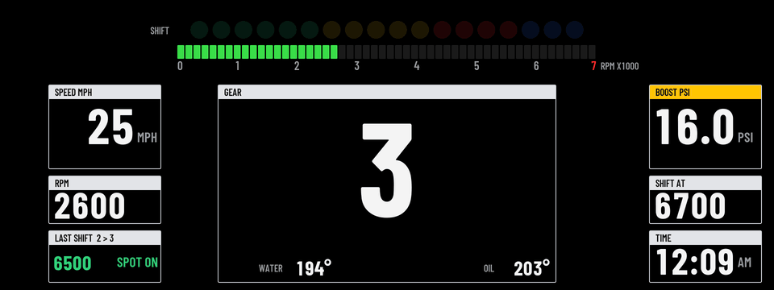
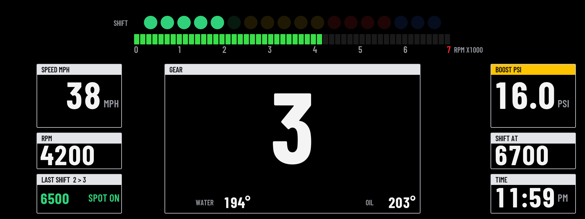
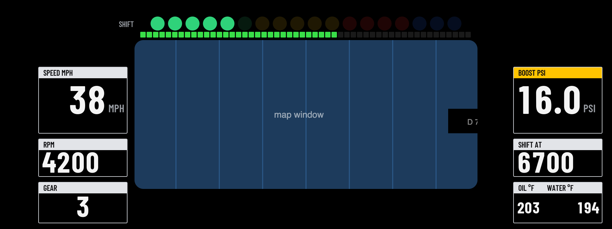
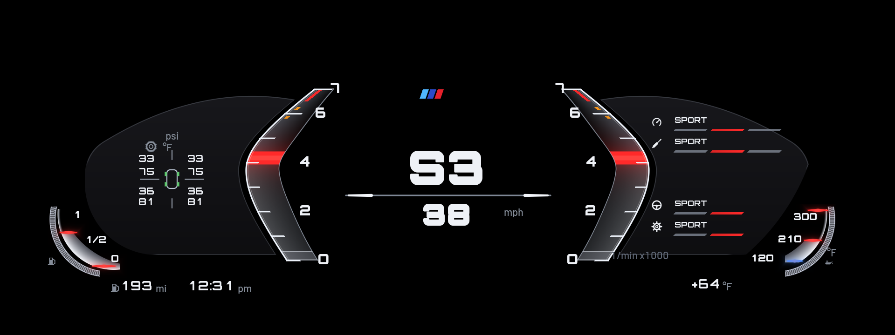

# Custom Cluster

Redraws the whole instrument cluster in a theme of your choice. Open **Custom Cluster** from the apps menu on the center screen and pick the theme there.

## Themes

### GT3

A race dash.

- **Top:** 18 round shift lights (green, yellow, red, then blue) and a segmented rev bar. The lights come on from 3000 rpm and fill up to your shift point.
- **Left:** speed, rpm, and your last shift with its grade.
- **Middle:** the gear, with water and oil temperatures.
- **Right:** boost, your shift point, and the clock.
- **At the shift point** the lights, the rev bar, the rpm and the gear all go red.

### M

A current M8's cluster, traced off a photo of it and drawn on black.

- **Middle:** two bowed glass rev blades either side of the gear and speed, reading 0 to 7000 rpm like the M40i's own cluster. A red marker rides each blade at the rpm, the blade glows below it, and orange and red marks sit before and past your redline. The gear shows with its shifter programme: P, D3, S3 or M3.
- **Left:** a near-black card with the tyre block: pressure and temperature at each corner round a car glyph (from the car's tyre monitor, read every 10 seconds, in the car's own units). The fuel dial sits over the card's lower corner, drawn like the M8's: a thin glass bracket inside a hatched chrome bezel, lit from the bottom up to the level, with a red streak at the level and another at the reserve.
- **Right:** what the engine, chassis, steering and gearbox are set to, as rows with a step bar (two above BMW's black gear box and two below it, since the car paints over that spot), and the oil temperature dial, the same glass bracket (blue streak at the cold end, red at the hot end). The rows follow the drive mode buttons: Eco Pro, Comfort, Sport, Sport Plus and Sport Individual. The car only reports that an Individual setup is on, not what each part is set to, so those rows read INDIVIDUAL.
- **Bottom:** range, the clock, and the outside temperature.

### Sport

The look of BMW's newer Live Cockpit Sport view.

- **Left:** speed as a blue bracket on BMW's 0 to 200 mph scale (0 to 320 km/h), with the digital speed and a fuel bar inside it.
- **Right:** revs as a red bracket on the M40i's 0 to 7000 rpm scale, with yellow and red marks around your redline, with the gear and an oil temperature bar inside it.
- **Middle:** black, or BMW's map with "Leave room for the map" on.
- **Bottom:** boost and coolant in the blue and red strip, plus the clock, range and outside temperature.

More themes are on the way.

## Off and drive modes

- **Off (BMW's own cluster):** pick it as the theme and the app draws nothing, so BMW's cluster comes back.
- **Change with SPORT / COMFORT / ECO PRO** (on by default): the cluster follows the drive mode buttons, with a theme for each mode. Out of the box, Sport shows GT3, and Comfort and Eco Pro show BMW's own cluster. Until the car reports a mode, the plain theme setting is used.
- **With Custom HUD:** the cluster theme and the HUD cannot show at the same time, because cluster-render has one screen slot for both. With the defaults, Sport gets the cluster theme and Comfort gets the HUD, so they take turns.

## Settings

- **Theme**, and one per drive mode.
- **Leave room for the map:** cuts a window out of the dash so BMW's map shows through, moves the gear and temperatures to the sides, and slims the rev bar. Works in GT3 and Sport.
- **Units:** mph, °F, psi or km/h, °C, bar.
- **Clock:** 12-hour or 24-hour.
- **Redline:** where the red marks start on the rev scales (they always cover at least the last 500 rpm, and the yellow marks sit in the 700 rpm before them).
- **Shift point before redline:** how far below the redline the shift lights peak (300 rpm by default).
- **Cold-engine rev guard:** until the oil reaches 80°C, the shift point starts at 4500 rpm and climbs as the oil warms up.
- **Show boost.**
- **Demo data:** fake driving data for trying it out parked.
- **Calibration grid:** a theme that draws lines every 50 px with labels, for checking on a photo where things land on the real screen. It also carries a few test marks used to measure cluster-render's limits on the car.

**Shift grades:** every upshift is graded on its peak rpm. EARLY means more than 250 rpm under the shift point, LATE more than 200 over it, COLD REV the same while the cold guard is on, LIMITER within 60 rpm of the redline, and anything in between is SPOT ON.

## Requirements

[cluster-render](https://github.com/robertnisipeanu/idrive-apps), installed from the `robertnisipeanu/idrive-apps` Store source.

## On the car

Tested on a 2020 X3 M40i. GT3 draws complete. The car draws at most 8 layers per connection, and every theme fits in that. Still to be checked:

- whether M and Sport draw complete (if not, the first row of the app's page says how many parts are drawn and why the rest are not);
- whether BMW's warning lights still show over the dash (start the car with a seat belt off and look);
- the drive mode switching and the map window's position;
- how the colours and edges look on the real screen.

Version history is in the repo's [CHANGELOG.md](../../CHANGELOG.md).
