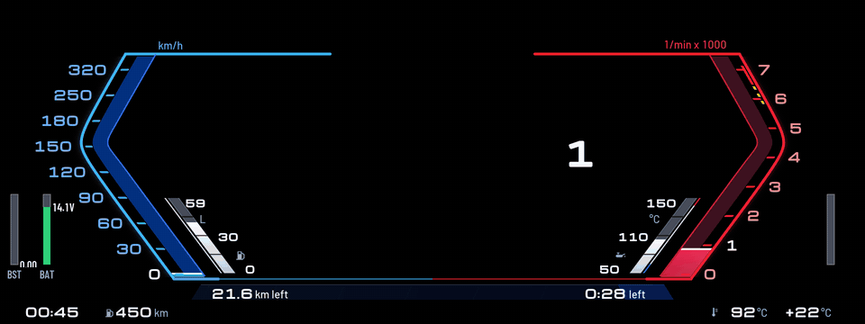
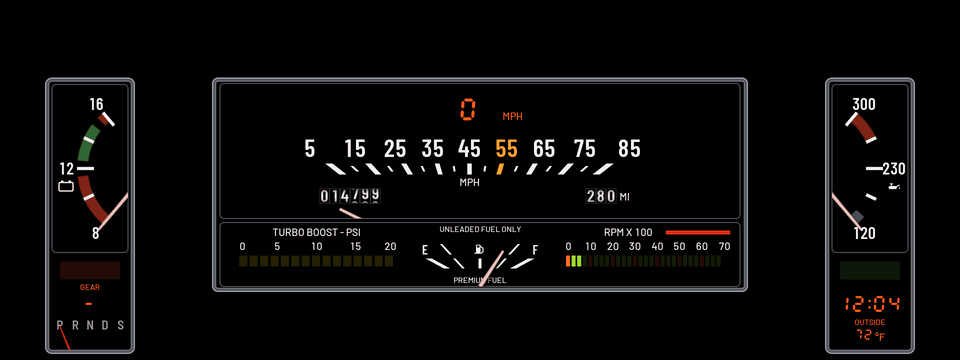

# Custom Cluster

Redraws the whole instrument cluster: a 1987 Buick Grand National dash, switching to a Sport view round BMW's map while you navigate. Open **Custom Cluster** from the apps menu on the center screen to change it.

## Themes

### Sport

The look of BMW's newer Live Cockpit Sport view.

- **Left:** speed as a blue bracket on BMW's 0 to 200 mph scale (0 to 320 km/h), with the digital speed and a fuel bar inside it.
- **Right:** revs as a red bracket on the M40i's 0 to 7000 rpm scale, with yellow and red marks around your redline, with the gear and an oil temperature bar inside it.
- **Middle:** BMW's map while navigating, else black.
- **Bottom:** boost and coolant in the blue and red strip, plus the clock, range and outside temperature.
- **While navigating:** the strip becomes the route's progress, filling from the right, with the distance left and the time left at its ends.

 While navigating: BMW's map shows in the middle (black here)

### Grand National (1987)

The look of a 1987 Buick Grand National's dash: chrome frames, white numbers, pink needles and an orange VFD.

- **Left pod:** a 12 V voltmeter (8 to 16 V), with the parking brake lamp (red PARK BRAKE, or green AUTO HOLD while Auto Hold holds the car), the gear number (in orange VFD digits, a dash when there is none), and under it P R N D S in see-through white with a red needle behind them, showing through the selected one (S also in M). It eases from letter to letter, passing N as BMW's selector does, and stays put when the car sends no gear.
- **Right pod:** oil temperature (50 / 110 / 150 °C), with the CRUISE lamp (lit green while ACC is on), the clock and the outside temperature under it.
- **Middle, top:** a needle over a straight row of mph numbers, 5 to 85, with 55 in amber at the centre. Over the 55, the speed in big orange VFD digits (mph or km/h by the units setting); under it, a rolling odometer: six drums of white digits that turn as a real one's do (miles or km by the units setting; the last drum turns with the distance driven), and the needle sweeps over it. No turn signals: BMW's own indicator sound stays.
- **Middle, bottom:** the fuel gauge in the middle as the Grand National's (UNLEADED FUEL ONLY over it, PREMIUM FUEL under it, E, the pump and F standing on the line its marks split at), a yellow LED boost bar (0 to 1.5 bar) on its left, and on its right an LED rev bar from 0 to 7000 rpm, green with each 1000's segment orange, under a red mark from your redline to the end.
- **Bottom:** BMW's belt light and gear letter. There is no map window.

What never changes while driving (the chrome frames, the marks, the coloured zones and the labels) is drawn once, as one compressed image for each Units setting, and only what moves is drawn live over it: 1.5 MiB of cluster-render's pixel memory instead of 7.4, and a much smaller shader. It needs cluster-render 0.5.9 or later, as Custom HUD does.

More themes are on the way.

## Navigation and Off

- **While navigating:** while BMW's route guidance is on, the cluster switches to this theme (Sport by default, with the map window open), and back to your theme when the route ends.
- **Off (BMW's own cluster):** pick it as the theme and the app draws nothing, so BMW's cluster comes back.
- **With Custom HUD:** both show together on cluster-render 0.5.1 or later (the panel has its own scene id). On older versions, or if the KOMBI refuses the panel's id, they take turns; see [Both apps at once](../../README.md#both-apps-at-once).

## Settings

- **Theme:** Grand National or Sport (or Off).
- **While navigating:** Sport with the map, Grand National, Off, or no change.
- **Units:** mph, °F, psi or km/h, °C, bar.
- **Clock:** 12-hour or 24-hour.
- **Redline:** where Grand National's rev LEDs turn yellow, and where the red marks start on Sport's rev scale (they always cover at least the last 500 rpm, and the yellow marks sit in the 700 rpm before them).
- **Demo data:** fake driving data for trying it out parked.
- **Calibration grid:** a theme that draws lines every 50 px with labels, for checking on a photo where things land on the real screen. It also carries a few test marks used to measure cluster-render's limits on the car.

**Shift grades:** every upshift is graded on its peak rpm. EARLY means more than 250 rpm under the shift point, LATE more than 200 over it, LIMITER within 60 rpm of the redline, and anything in between is SPOT ON.

## Requirements

[cluster-render](https://github.com/robertnisipeanu/idrive-apps), installed from the `robertnisipeanu/idrive-apps` Store source or `james10424/idrive-apps-lib`, 0.5.1 or later to show together with the other app.

## On the car

Tested on a 2020 M340i. cluster-render draws up to 64 layers per connection (since 0.4.2), and every theme uses far fewer. Still to be checked:

- whether Sport and Grand National draw complete (if not, the first row of the app's page says how many parts are drawn and why the rest are not);
- whether BMW's warning lights still show over the dash (start the car with a seat belt off and look);
- the switch to Sport when route guidance starts, and the map window's position;
- how the colours and edges look on the real screen.

Version history is in the repo's [CHANGELOG.md](../../CHANGELOG.md).
