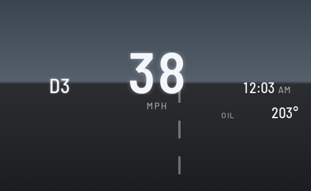
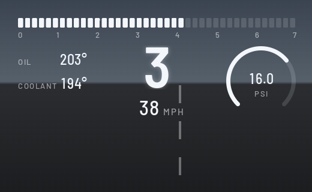
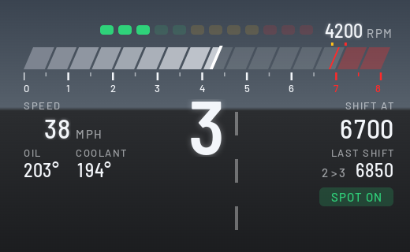
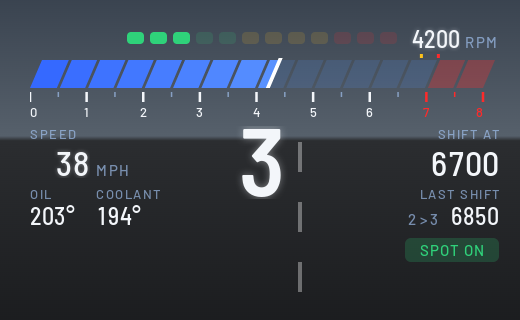
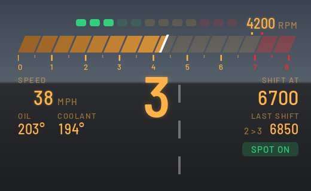

# Custom HUD

Puts your own readouts on the windshield HUD: speed, gear, a shift bar, boost, oil and coolant temperatures, and a clock, or your own Live2D character standing in the corner of the HUD. Open **Custom HUD** from the apps menu on the center screen and pick the layout, theme, units and widgets there.

## Layouts

<table align="center">
  <tr>
    <th align="center">Daily</th>
    <th align="center">Sport</th>
  </tr>
  <tr>
    <td></td>
    <td></td>
  </tr>
</table>

- **Daily:** speed is the hero, with the gear, clock and oil.
- **Sport:** a segmented shift bar, a big gear, speed, a boost gauge, oil and coolant.
- **Miku:** a Live2D character you own stands at the bottom right of the HUD, clear of BMW's speed and speed-limit sign. No readouts of our own, just her and BMW's HUD.
  - **Bring your own model:** no character ships with the app. You bake frames from a Live2D model on your own computer with [tools/live2d_bake](../../tools/live2d_bake/README.md) and copy them to the car with `scripts/deploy.sh <car> --miku <folder>` ([deployment steps](../../tools/live2d_bake/README.md#deploy-to-the-car)). The app reads them from `miku/` in its data folder. Until they're there the layout draws nothing and the status row says why.
  - **Like standing on a bus:** pull away and she leans right, brake and she leans left, with the model's own body and head moving (her happy face when you pull away hard, her braking face when you brake hard). When the car settles she sways back past upright once or twice before standing still. Her arm on the side away from the lean swings up and out to catch her balance (the other a little), and her twin tails move with her head.
  - **Idle:** she blinks, breathes, sways a little and smiles as if talking now and then. The faster you go, the more her twin tails spread, lift and flutter.
  - **Glancing and dozing:** a second after the car stops pulling or braking (under 0.03 g) she starts glancing left and right now and then, eyes first, then her head, holding a second or three. Stopped for 15 s, she dozes off: eyes shut, head drooping, nodding awake now and then. Pulling away or braking wakes her and the lean takes over.
  - **Legs:** her feet stay planted while her hips move with the lean, and her knees flex a little as she sways. Now and then, while idle, she shifts her weight onto one leg and bends the other knee.
  - **During route guidance** she steps aside, because BMW's turn map and street name fill her corner; she comes back when the route ends.
  - The frames go up once as one image (about 9 MiB of cluster-render's 16 MiB pixel memory), and the GPU animates them on cluster-render's own clock: one layer, and only a tiny update goes up while she moves.
  - Redline is gone: if you had it picked anywhere, it switches to Miku (so does Perch, its working name).

## Themes

Classic, M and Night, plus Auto, which switches to Night at sunset. You choose which theme Auto uses in daytime.

<table align="center">
  <tr>
    <th align="center">Classic</th>
    <th align="center">M</th>
    <th align="center">Night</th>
  </tr>
  <tr>
    <td></td>
    <td></td>
    <td></td>
  </tr>
</table>

## Off and drive modes

- **Off (BMW's own HUD):** pick it as the layout and the app draws nothing, so BMW's HUD comes back.
- **Change with SPORT / COMFORT / ECO PRO** (on by default): the HUD follows the drive mode buttons, with a layout for each mode. Out of the box, Comfort shows Daily, and Sport and Eco Pro hand the HUD back to BMW. In Sport, BMW's own HUD puts its speed and rev line in the middle of the window, right where these layouts sit. Until the car reports a mode, the plain layout setting is used.
- **With Custom Cluster:** by default the HUD and the cluster theme take turns, because cluster-render gives them one scene id: whichever shows first keeps it, and the page says "waiting: the cluster layout has the scene the HUD shares". Set `hud_scene_id = 0x010004f0` in cluster-render (0.4.5 or later) and both show together; see [Both apps at once](../../README.md#both-apps-at-once).

## Settings

Layout, drive mode switching, theme, daytime theme for Auto, units (mph, °F, psi or km/h, °C, bar), 12- or 24-hour clock, redline and shift point (the Sport shift bar), cold-engine rev guard, which readouts show (clock, oil, coolant, boost), and demo data. Changes show on the HUD right away, and the HUD keeps running after you leave the page.

The page's first row says what the HUD is doing, the drive mode it sees, and why anything is not drawn (for example "waiting: another app has this display").

**Boost:** read from the car's sport display signal. When the car does not send it, the app asks the engine computer directly (read only), the same way Car Vitals does.

## The visible window

The HUD is an 800x480 screen, but only part of it comes through the windshield. Measured from a photo of the calibration grid on a 2020 X3 (Nov 5 2026), the visible window is **x 120, y 100, 485 x 278**. It moves a little with eye position and HUD height, and every layout sits inside it.

BMW keeps drawing its own HUD content over ours. In Comfort mode that is the speed readout and the speed-limit sign in the bottom-left of the window, so the layouts keep **x 150..355, y 314..378** free for it.

**Calibration grid:** pick it as the layout to see lines every 50 px with labels on the glass. A photo of it shows exactly which part of the HUD is visible; take a new one if the HUD height or the seat changes a lot. The grid also carries a few test marks used to measure cluster-render's limits on the car.

## Requirements

[cluster-render](https://github.com/robertnisipeanu/idrive-apps), installed from the `robertnisipeanu/idrive-apps` Store source (0.4.5 or later, from `james10424/idrive-apps-lib` for now, to show together with the other app). Without it, the status row reads "HUD off: cluster-render is not installed or not running".

## On the car

Tested on a 2020 X3 M40i. It runs, the rpm is smooth at idle, and the layouts were fitted to the visible window from the grid photo. Still to be checked:

- the fitted layouts on the glass: nothing cut off, nothing under BMW's speed and sign;
- the drive mode switching and the engine computer boost;
- how the colours and edges look on the real glass, especially the M blues in sunlight;
- whether the head unit's clock is in local time.

Version history is in the repo's [CHANGELOG.md](../../CHANGELOG.md).
